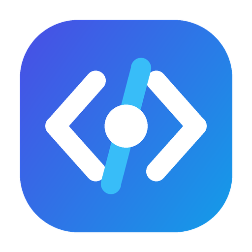
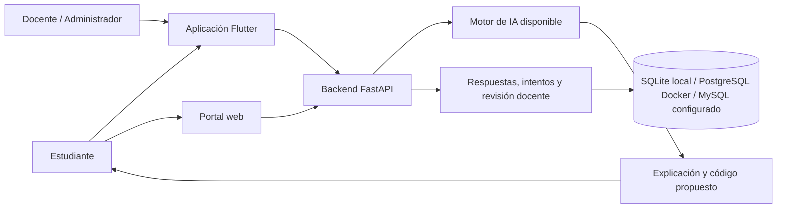

<div align="center">
  
  <h1>Sistema Explicador Python IA</h1>
  <p><strong>Programar, comprender y aprender con andamiaje explicativo.</strong></p>
  <p>Aplicación de escritorio · Portal web · Backend local · Investigación educativa</p>
  
  
  
  
</div>

---

## Bienvenido

PythonIA acompaña a estudiantes universitarios en la creación y comprensión de programas Python. La tesis estudia la diferencia entre **generación directa** y **generación con andamiaje explicativo**: propósito, pasos, variables, predicción, práctica guiada y reflexión sobre el código.

El aprendizaje se mide mediante pretest, postest y revisión docente. Una respuesta breve puede ser correcta; una respuesta extensa también. La valoración debe atender al razonamiento y a la rúbrica, no a la longitud ni a la aprobación del modelo. Las respuestas y ayudas quedan asociadas al estudiante en la base de datos.

> **Entrega del código fuente:** el repositorio incluye la aplicación y su configuración. Los pesos del modelo, los motores binarios, las credenciales y los datos de estudiantes se entregan por separado. Arrancar la aplicación no equivale a tener un modelo disponible ni garantiza que sus respuestas sean correctas.

**Accesos rápidos:** [Instalar e iniciar](#instalar-e-iniciar) · [Docker](#iniciar-con-docker) · [Administración](#administración-y-evaluación) · [Instalador](#preparar-un-instalador-para-estudiantes) · [Documentación](#documentación)

## Tres botones, tres propósitos

Descarga y extrae el repositorio, o clónalo. En Windows, abre la carpeta y haz doble clic:

| Archivo | Qué inicia | Opciones |
|---|---|---|
| **`EJECUTAR_SISTEMA_TESIS.bat`** | Backend + portal web + aplicación Flutter desde el código actual | Normal local o Docker para backend/web; Flutter siempre se ejecuta en Windows |
| **`iniciar_backend.bat`** | Solamente backend y su base de datos | Normal local o Docker; en Docker inicia PostgreSQL |
| **`iniciar_sistema.bat`** | Solamente la aplicación Flutter | Usa el backend que ya esté activo o el servidor configurado en la aplicación |

Los lanzadores comprueban las herramientas y descargan automáticamente las dependencias del componente solicitado. No instalan Python, Flutter, Visual Studio, Node ni Docker. La primera ejecución necesita Internet y puede tardar; las siguientes reutilizan las dependencias instaladas.

## Instalar e iniciar

### Requisitos para Windows

| Componente | Requisito | Comprobación |
|---|---|---|
| Backend normal | Python **3.11 o superior**, disponible en PATH | `python --version` |
| Portal web normal | Node.js **22 o 24 LTS**, con npm | `node --version` |
| Aplicación desde código | Flutter stable con **Dart >=3.10.1**, Visual Studio 2022 con **Desktop development with C++** y Windows SDK | `flutter doctor -v` |
| Backend/web Docker | Docker Desktop iniciado, motor de contenedores Linux y Compose v2 | `docker info` y `docker compose version` |
| Instalador futuro | Inno Setup 6; solamente en el equipo que genera el instalador | `ISCC` o editor Inno Setup |

Versiones comprobadas en el equipo de desarrollo: Python **3.14.3**, Flutter **3.44.6 / Dart 3.12.2**, Node **24.18.0** y Docker Engine **29.8.1**. El contenedor usa Python 3.11 y Node 22. El entrenamiento y la inferencia opcional pueden necesitar requisitos adicionales a los del backend web.

Descargas oficiales: [Python](https://www.python.org/downloads/) · [Flutter para Windows](https://docs.flutter.dev/install) · [Visual Studio](https://visualstudio.microsoft.com/downloads/) · [Node.js](https://nodejs.org/en/download) · [Docker Desktop](https://docs.docker.com/desktop/setup/install/windows-install/) · [Inno Setup](https://jrsoftware.org/isdl.php).

### Primera ejecución normal

1. Descarga el ZIP desde GitHub y extráelo completo, o ejecuta:
   ```powershell
   git clone https://github.com/luisitoarana/modelo-ia-programacion.git
   cd modelo-ia-programacion
   ```
2. Instala los requisitos de los componentes que utilizarás. Reinicia la terminal después de modificar PATH.
3. Haz doble clic en **`EJECUTAR_SISTEMA_TESIS.bat`** y selecciona **1: Normal local**.
4. Se crea `backend/.venv`, se instalan los paquetes Python, se prepara `backend/.env`, se ejecuta `npm ci` y se descargan los paquetes de Flutter. El backend y la web se inician; Flutter compila la aplicación actual.
5. Abre la aplicación o el portal en **http://localhost:3000**. La API está en **http://127.0.0.1:8765/docs**.

**Configuración privada:** una instalación nueva genera un secreto y una contraseña de administrador aleatorios. Consulta `ADMIN_EMAIL` y `ADMIN_PASSWORD` en **`backend/.env`** para entrar. Si ya existe configuración, se conserva; si solamente existe `.env` en la raíz, se importa sin reemplazar sus valores. El archivo de `backend` tiene prioridad. Las credenciales de una cuenta existente no se restablecen al editar este archivo.

La referencia de variables está en **`backend/.env.example`**. Las versiones Python comprobadas se conservan en `backend/requirements-lock.txt` y las del portal en `frontend/package-lock.json`.

**Base de datos local:** una instalación nueva usa SQLite en `backend/local.db`. Si tu `.env` ya apunta a MySQL o PostgreSQL, ese servidor debe estar disponible; el lanzador conserva esa conexión y no instala esos servidores fuera de Docker.

### Instalar dependencias sin abrir ventanas

```powershell
powershell -NoProfile -ExecutionPolicy Bypass -File scripts/iniciar.ps1 -Componente Sistema -Modo Nativo -SoloInstalar
```

Para un solo componente, sustituye `Sistema` por `Backend` o `App`. La opción `-SinAbrirApp` permite verificar backend/web sin compilar Flutter. El backend queda en segundo plano y sus registros están en `%LOCALAPPDATA%\SistemaExplicadorPythonIA\logs`.

## Iniciar con Docker

**Sin Python ni Node en el host:** con Docker Desktop iniciado, ejecuta **`iniciar_backend.bat`**, opción **2**. Para backend + web + escritorio utiliza **`EJECUTAR_SISTEMA_TESIS.bat`**, opción **2**; el escritorio sí necesita Flutter y Visual Studio.

Docker construye las imágenes, inicia PostgreSQL, espera su disponibilidad y después inicia la API. El sistema completo añade el portal web. Los datos de PostgreSQL permanecen en el volumen `db_data`. No se copia la base SQLite ni se migra automáticamente información de otras instalaciones.

Una vez preparado `backend/.env`, también puedes iniciar **backend + web**, sin Flutter, desde la terminal:

```powershell
docker compose --env-file backend/.env up -d --build --wait
docker compose --env-file backend/.env ps
docker compose --env-file backend/.env logs --tail=50 backend
```

Para detenerlos conservando la base de datos:

```powershell
docker compose --env-file backend/.env down
```

No uses `down -v` para una instalación con estudiantes: elimina los volúmenes. Docker publica solamente en `127.0.0.1`: API **8765**, web **3000**; PostgreSQL no tiene un puerto publicado. El puerto 8000 es interno del contenedor.

**Modelo local:** coloca el archivo recibido por separado en `models/asistente_python_ia_v1.gguf`. Docker incluye el motor de inferencia por CPU; su compilación hace más lenta la primera construcción. Para comprobar únicamente infraestructura, configura `INSTALL_LOCAL_MODEL=false` en `backend/.env`; entonces no habrá inferencia GGUF en esa imagen. La aceleración GPU requiere una configuración adicional y no se presupone en Docker.

En Windows, el motor ya preparado se ubica en `backend/llama_bin/` y necesita sus bibliotecas junto al ejecutable. Como alternativa por CPU, con compilador C/C++ y CMake disponibles:

```powershell
backend\.venv\Scripts\python.exe -m pip install -r backend/requirements-local-model.txt
```

Ni los modelos de investigación ni la inferencia se entrenan al hacer clic en iniciar. Revisa el estado del modelo dentro de la aplicación. El backend puede funcionar para autenticación y administración aunque no haya pesos; el chat necesita un motor configurado.

## Qué contiene el sistema



| Módulo | Función |
|---|---|
| Chat | Conversaciones y consultas de programación |
| Explicar código | Explicación, práctica guiada, preguntas y registro de respuestas |
| Editor de código | Archivos, continuidad de conversación, propuestas de cambios y ejecución |
| Explorador | Lectura y explicación de archivos del proyecto permitido |
| Administración | Participantes, asignación experimental, intentos, revisión y exportaciones |
| Investigación | Protocolo pre/post, evaluación del modelo y entrenamiento opcional |

### Administración y evaluación

**Cuenta privada del administrador:** el correo y la contraseña reales se configuran únicamente en `backend/.env`, excluido de Git. No existen credenciales privadas incrustadas en la aplicación o en este README. Para crear o actualizar esa cuenta con los valores del archivo privado:

```powershell
Push-Location backend
.\.venv\Scripts\python.exe scripts/configurar_cuentas.py --admin
Pop-Location
```

**Cuenta pública de demostración:** `demo.estudiante@example.org`, contraseña **`DemoPythonIA2026!`**. Tiene únicamente rol de estudiante y, al crearla, empieza en pretest. Para habilitarla en tu propia instalación, ejecuta desde `backend`:

```powershell
.\.venv\Scripts\python.exe scripts/configurar_cuentas.py --demo
```

Esta cuenta compartida es solo para demostrar el sistema: cualquiera que lea GitHub puede utilizarla en una instalación que la habilite y consultar sus respuestas de prueba. No introduzcas datos personales ni la uses como participante de la tesis. Cada estudiante real debe registrarse con su cuenta individual. El código publicado no contiene la base de datos del servidor; descargarlo no crea automáticamente usuarios en otro equipo.

**Administrador público para probar el código abierto:** `demo.admin@example.org`, contraseña **`DemoAdminPythonIA2026!`**. Se crea en un servidor de demostración independiente, con su propia base de datos y firma de sesiones. Desde `backend`, después de instalar las dependencias:

```powershell
.\.venv\Scripts\python.exe scripts/iniciar_demo_admin.py
```

El servidor demo escucha solo en `http://127.0.0.1:8766`. En **Configuración → Avanzado → Conexión al backend** de la aplicación cambia la URL a `http://127.0.0.1:8766/api/v1` y entra con el administrador público. Para regresar a tu instalación privada, restaura la URL anterior e inicia sesión con tu cuenta privada. El servidor normal sigue utilizando su `.env` y su puerto habitual. El script demo no carga ese archivo ni hereda sus claves: sus usuarios y respuestas están en `backend/.runtime/demo-admin/demo.db`. Cualquier usuario que conozca las credenciales públicas tiene control de los datos de esa demostración; utiliza exclusivamente datos ficticios. Para crear sus cuentas sin iniciar el servidor, añade `--preparar` al comando. No publiques este servidor de demostración como servidor de alumnos.

En Docker, reconstruye el backend después de actualizar el código y ejecuta el aprovisionamiento dentro del contenedor. Este utiliza las credenciales privadas recibidas desde `backend/.env`:

```powershell
docker compose --env-file backend/.env up -d --build db backend
docker compose --env-file backend/.env exec backend python scripts/configurar_cuentas.py --admin --demo
```

La actualización explícita de administrador reemplaza su contraseña por la del archivo privado; el arranque normal no restablece contraseñas de cuentas existentes.

En **Administración → Participantes**, asigna a cada alumno la fase **pre**, **intervención** o **post**. En pre y post se bloquea la asistencia de IA. En la revisión se reúnen sus respuestas, código y calificación docente, con exportación CSV/JSON. El administrador puede consultar la información; la calificación corresponde a la persona docente autorizada, no al modelo.

Inicia sesión con la cuenta administradora y abre **Administración** en el menú de la aplicación. Allí se consultan participantes e intentos, se revisan respuestas y se exportan evidencias. La calificación docente se conserva separada de los comentarios del asistente. Los estudiantes pueden registrarse desde la propia aplicación.

Para ver o probar las evaluaciones, pulsa **Pretest, postest y vista previa docente** dentro de Administración. También puedes abrir el panel desde el selector superior **Pretest y postest**. Los botones **Vista previa pretest** y **Vista previa postest** muestran las preguntas seleccionadas, permiten escribir respuestas y simular la entrega incluso cuando el examen está cerrado. La simulación no crea entregas ni resultados de estudiantes. Tu cuenta conserva su rol de administrador y los controles de apertura, asignación, revisión y exportación. El bloqueo sin IA de las evaluaciones se aplica a los estudiantes; el administrador no debe asignarse como participante para inspeccionarlas.

La cuenta que entra no representa a todos los estudiantes: cada uno utiliza su usuario. Antes de recoger datos, define el grupo, el consentimiento, la rúbrica y el pre/post en el [protocolo experimental](research/PROTOCOLO_PRE_POST_ANDAMIAJE.md). No publiques respuestas, correos ni exportaciones de estudiantes en GitHub.

### Pretest y postest por estudiante

Abre **Pretest, postest y revisión docente** desde la aplicación. Puedes activar el estudio, abrir/cerrar cada test, seleccionar cinco o seis preguntas y asignar grupo/fase. Se proponen seis pares, dos por módulo: **pre y post sin IA para ambos grupos**; durante la intervención un grupo recibe generación directa y el otro andamiaje explicativo.

Las respuestas, incluso incorrectas o vacías, se entregan al servidor. El docente revisa con rúbrica, exporta CSV/JSON y consulta la comparación individual cuando ambas fases estén calificadas. Las preguntas de un instrumento iniciado no cambian. La cuenta pública sirve para demostraciones; cada participante real necesita una cuenta propia.

**Orden de aplicación:** abre el pretest y asigna a cada alumno su grupo y fase **Pretest**. Cuando entregue, usa **Asignar grupo/fase → Intervención**. Al terminar la práctica, abre el postest y asigna la fase **Postest**. Abrir/cerrar un test controla si recibe entregas; cambiar tu selector superior solo cambia tu exploración como administrador, no el grupo de los alumnos.

Durante la intervención, el editor incluye **Práctica: generar código** para el grupo directo y **Práctica con andamiaje** para el otro grupo. Las consignas comunes se pueden copiar o enviar a la IA desde el apartado de tareas. El explicador ofrece **Tareas de práctica con andamiaje**, donde el alumno trabaja un intento y contrasta su predicción con la explicación. Son las mismas competencias del pre/post, con otros datos; el postest se resuelve sin ayuda para medir transferencia, no memorización. El servidor conserva la selección de competencias del pretest de cada participante y bloquea las tareas de práctica durante sus evaluaciones.

El banco es un **piloto pendiente de aprobación del profesor**. Consulta el [protocolo y las seis parejas de tareas](research/PROTOCOLO_PRE_POST_ANDAMIAJE.md) y la [validación del flujo](docs/VALIDACION_ESTUDIO_2026-10-22.md). No se atribuye un efecto educativo a las pruebas del software.

### Editor y explicador

El editor mantiene una conversación y envía el archivo actual. Las solicitudes de modificación y las confirmaciones de una propuesta pueden aplicar cambios a la pestaña original; el código Python se valida sintácticamente antes de sustituirlo. Si cambias el archivo mientras llega la respuesta, se conserva tu edición. Revisa el diff y prueba el resultado: sintaxis válida no demuestra corrección funcional.

En **Solo código**, las peticiones de corrección conservan el archivo actual y no se interpretan como programas nuevos por incluir «genera». La respuesta debe contener una única solución Python, sin explicaciones didácticas. Se comprueban sintaxis e importaciones de algunas bibliotecas básicas; una propuesta rechazada tiene como máximo un intento de reparación con el mismo motor. Si falla, se informa y se conserva el archivo. Estas comprobaciones no prueban cualquier comportamiento del programa.

En el explicador, la petición incluye la predicción y el razonamiento del alumno. Si se solicitó explicar sin modificar y el modelo cambia el código, se conserva el original y se muestra una explicación de respaldo basada en su estructura, identificada como tal. Las preguntas se anclan al código analizado. No se atribuye una calificación ni aprendizaje demostrado a una respuesta de la IA.

Los archivos largos se aceptan en el transporte, pero el motor tiene un contexto limitado. Cuando deba recortar contenido, la explicación es parcial y no se debe reemplazar automáticamente el archivo completo. Las pruebas del modelo deben incluir varios turnos, errores, cambios de requisitos y preguntas diferentes; la documentación de validación registra el alcance real.

## Estructura del repositorio

```text
sistema-explicador-python-ia/
├── backend/                 API, configuración privada, dependencias y Dockerfile
│   ├── app/                 Rutas, modelos de datos, servicios y seguridad
│   ├── scripts/             Preparación del entorno del backend
│   └── tests/               Pruebas HTTP, aprendizaje y continuidad
├── app-desktop/             Aplicación Flutter, recursos y pruebas
├── frontend/                Portal Next.js, dependencias y Dockerfile
├── mcp_server/              Herramientas compartidas para archivos y ejecución
├── ml/                      Código de entrenamiento e inferencia de investigación
├── research/                Protocolo y metodología de la tesis
├── docs/                    Manuales, arquitectura y evidencias documentadas
├── scripts/                 Orquestación y comprobaciones del proyecto
├── knowledge_base/          Material de consulta
├── models/                  Pesos externos; excluidos de Git
├── docker-compose.yml       Orquestación de PostgreSQL, API y web
└── *.bat                    Los tres accesos de inicio
```

### Bases de datos: elige una por instalación

| Motor | Cuándo se usa | Persistencia |
|---|---|---|
| SQLite | Prueba local nueva, sin instalar un servidor de BD | `backend/local.db` |
| PostgreSQL 16 | Docker Compose; también configurable fuera de Docker | Volumen `db_data` o servidor propio |
| MySQL | Instalación existente configurada con `mysql+aiomysql://...` | Servidor MySQL externo |

Los tres controladores están declarados en el backend. No se inician tres bases a la vez. Cambiar `DATABASE_URL` no transfiere usuarios o respuestas: requiere un plan de migración y respaldo.

## Preparar un instalador para estudiantes

**Hoy se entrega el código y el arranque; generar el instalador es un paso posterior.** El cliente distribuido no necesita Python, Node ni Docker. Se conecta al backend del docente, que debe seguir activo. `localhost` en la computadora de un estudiante apunta a su propia computadora: para distribuir utiliza la dirección real del servidor.

| Archivo | Propósito |
|---|---|
| `empaquetar.ps1` | Compila Flutter release y copia únicamente el cliente a `release/<versión>/desktop`; recibe `-ApiUrl` |
| `empaquetar_cliente_zip.ps1` | Comprime ese cliente en un ZIP con su versión |
| `instalador_inno_setup.iss` | Plantilla de instalador Windows por usuario, con logo y accesos directos |
| `entrenar_vision.ps1` | Experimento opcional: genera datos y entrena visión; consume GPU y horas. No participa en instalación ni arranque |

La versión proviene de `app-desktop/pubspec.yaml` (por ejemplo, `1.0.0+1`). Para una futura entrega:

```powershell
.\empaquetar.ps1 -ApiUrl "https://TU-SERVIDOR/api/v1"
.\empaquetar_cliente_zip.ps1
ISCC /DAppVersion=1.0.0 /DBuildVersion=1.0.0+1 instalador_inno_setup.iss
```

El logo original está en `app-desktop/windows/runner/resources/app_icon.ico`; el README utiliza su PNG en `docs/assets/logo.png`. Conserva el AppId de Inno Setup para actualizaciones. Prueba instalar, abrir, conectar, cerrar, actualizar y desinstalar en otra computadora antes de entregar. La firma digital del instalador y la actualización automática son trabajos separados.

Puedes pedir a **ChatGPT con Codex**:

> «Prepara el instalador de PythonIA usando esta plantilla Inno Setup y el logo del repositorio. Usa la versión del pubspec, configura la URL real del backend, no incluyas secretos, datos ni modelos, compila el cliente y verifica la instalación y desinstalación en Windows. Entrega el instalador versionado y un informe de las pruebas realizadas».

## Seguridad y publicación

Los lanzadores locales escuchan en la propia computadora. Docker ejecuta API/web con usuarios sin privilegios, mantiene PostgreSQL privado y no monta todo el repositorio en el explorador. El `.env` y los archivos de usuarios no se suben a Git ni al contexto de construcción.

Publicar el repositorio no publica el servidor. El acceso de estudiantes desde otras computadoras, HTTPS, DNS y el túnel del servidor se configuran en una fase posterior. Para ese despliegue revisa [infraestructura](docs/INFRAESTRUCTURA.md), define orígenes CORS exactos, contraseñas propias, respaldos, migraciones y aislamiento de ejecución. El ejecutor educativo no equivale a una frontera de seguridad para código hostil; no expongas un entorno de desarrollo a Internet.

No se promete ausencia absoluta de fallos o vulnerabilidades. La [validación de esta entrega](docs/VALIDACION_INSTALACION_2026-10-13.md) distingue las comprobaciones realizadas de las limitaciones pendientes.

## Solución de problemas

| Síntoma | Qué revisar |
|---|---|
| `python`, `flutter` o `npm` no encontrado | Instala el requisito, habilita PATH y abre una nueva terminal |
| Docker no responde | Abre Docker Desktop y comprueba `docker info`; usa contenedores Linux |
| Puerto 8765 o 3000 ocupado | Detén el servidor anterior que utilizaba ese puerto; no se matan procesos ajenos automáticamente |
| Backend nuevo pero interfaz vieja | Usa los BAT de código actual; un EXE compilado anteriormente conserva la interfaz anterior |
| Backend no inicia | Revisa `backend/.env`, conexión BD y `backend-error.log`; no borres una BD con alumnos |
| IA no disponible | Comprueba pesos y motor local; clonar el repositorio no descarga modelos |
| Falta una biblioteca al ejecutar código generado | Es una dependencia del programa generado; no se instala automáticamente código arbitrario ni paquetes pedidos por el modelo |
| Cambio reciente en Flutter | Pulsa `R` en su consola para reiniciar; `q` cierra la aplicación, sin detener la API |

## Documentación

- [Guía del profesor / jurado](docs/INSTALACION_JURADO.md)
- [Índice completo de documentación](docs/README.md)
- [Arquitectura](docs/arquitectura.md) y [documentación de API](docs/api_documentation.md)
- [Manual del administrador](docs/manual_administrador.md) y [manual de usuario](docs/manual_usuario.md)
- [Infraestructura y despliegue](docs/INFRAESTRUCTURA.md)
- [Protocolo pre/post y andamiaje](research/PROTOCOLO_PRE_POST_ANDAMIAJE.md)
- [Benchmark y criterios de evaluación](docs/BENCHMARK_TESIS_EVALUACION.md)
- [Entrenamiento de investigación](docs/MANUAL_ENTRENAMIENTO.md)
- [Validación de instalación](docs/VALIDACION_INSTALACION_2026-10-13.md)

La documentación histórica conserva los resultados de cada experimento. Para instalar esta versión, sigue este README y la guía del jurado.
