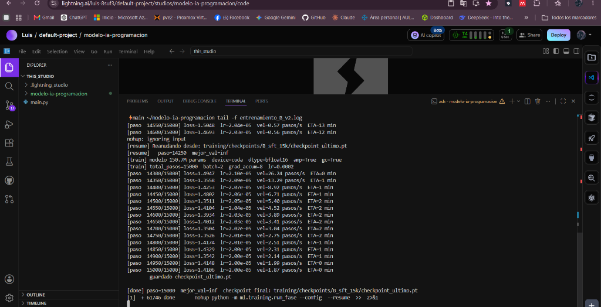
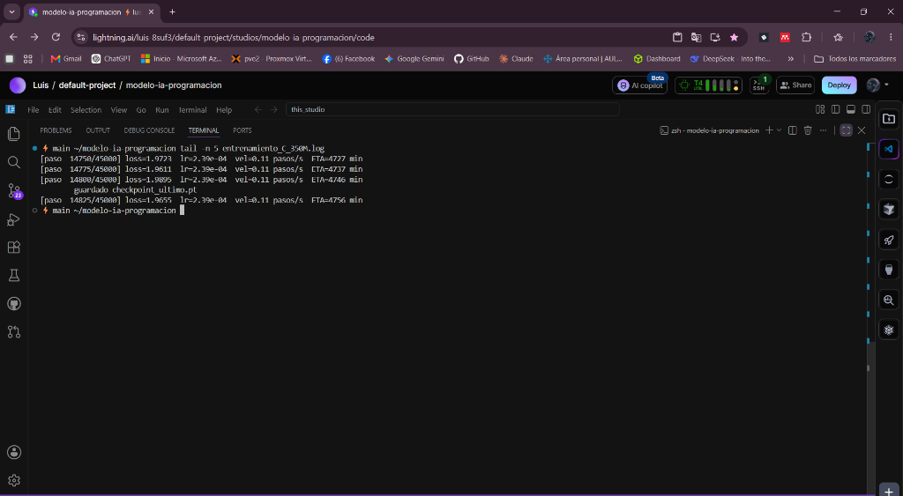
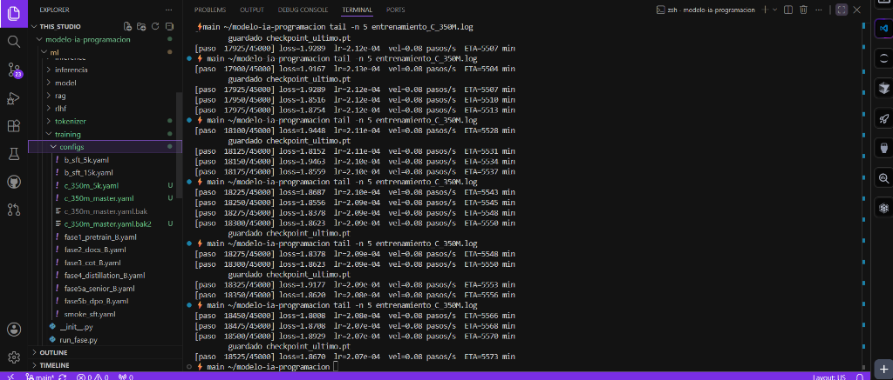
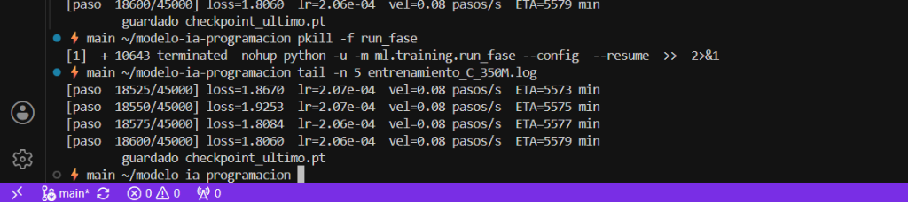

# Diario de Progreso

> Bitácora cronológica de la preparación, generación de datos, entrenamiento
> y evaluación del modelo. Cada sesión queda documentada con fecha, lo que
> se hizo, lo que salió, lo que se aprendió y los próximos pasos.

---

## Sesión 1 — Preparación inicial en Lightning AI

**Fecha**: 2026-06-21
**Lugar**: Lightning AI Studio (`Luis / default-project / modelo-ia-programacion`)
**Hardware**: CPU (Default, 4 cores, 0.33 créditos/h)

### Lo que se preparó previamente

- Repositorio público en GitHub: `https://github.com/luisitoarana/modelo-ia-programacion`
- Toda la base del proyecto: backend, frontend, app desktop, `ml/`, docs, research.
- `.gitignore` blindado (no se suben `.env`, modelos, datasets, builds, secretos).

### Acciones realizadas en esta sesión

1. Clonado del repo dentro del Studio:

   ```bash
   git clone https://github.com/luisitoarana/modelo-ia-programacion.git
   cd modelo-ia-programacion
   ```

2. Creación del `.env` local con las API keys de Groq (Gemini queda
   pendiente, opcional).

3. Verificación del entorno:

   ```bash
   python -c "import torch; print('PyTorch', torch.__version__)"
   # → 2.8.0+cu128
   ```

   - PyTorch 2.8 con CUDA 12.8 ya instalado por defecto en Lightning.
   - NumPy, httpx y todas las dependencias `requirements.txt` ya presentes.
   - El proyecto importa sin errores.
   - EduCodeEval carga 30 tareas correctamente.

4. Pool de proveedores activo: solo `groq` por ahora.

### Conclusiones de la sesión

- Lightning AI viene preconfigurado con todo el stack CUDA, ahorra los
  3-5 minutos de instalación que tomaría en otra plataforma.
- El repo está limpio y listo para ejecutar cualquier script `ml/...`.
- Próximo paso: descargar datasets públicos y generar el dataset V2
  propio en paralelo.

---

## Sesión 2 — Descarga de datasets públicos

**Fecha**: (a completar)
**Comando objetivo**:

```bash
python -m ml.data.download_hf \
    --dataset codealpaca,codefeedback,magicoder-oss,magicoder-evol,apps,mbpp,humaneval,ds-1000,humaneval-plus,mbpp-plus \
    --salida-dir datasets/publicos \
    --schema-v2
```

**Datasets a descargar**:

| Dataset | Tamaño aprox | Por qué |
|---|---|---|
| `codealpaca` | 20 000 ejemplos | Instrucciones → código didáctico. |
| `codefeedback` | 156 000 ejemplos | Instrucciones + crítica de código. |
| `magicoder-oss` | 75 000 ejemplos | Instrucciones derivadas de código OSS real. |
| `magicoder-evol` | 110 000 ejemplos | Instrucciones evolucionadas iterativamente. |
| `apps` | 10 000 problemas | Problemas competitivos con tests. |
| `mbpp` | 1 000 problemas | Mostly Basic Python Problems. |
| `humaneval` | 164 problemas | Benchmark estándar de generación. |
| `humaneval-plus` | 164 problemas | Versión con tests más rigurosos. |
| `mbpp-plus` | 378 problemas | MBPP con tests robustos. |
| `ds-1000` | 1 000 problemas | Data science (pandas, numpy, sklearn). |
| **Total aproximado** | **~373 000 ejemplos** | en formato V2 (schema unificado). |

**Tiempo estimado**: 1-3 horas según la red.
**Espacio en disco**: ~3-5 GB.

### Resultado

(A completar tras la ejecución: cuántos ejemplos exactos por dataset,
tiempos reales, errores si los hubo.)

---

## Sesión 3 — Generación del Dataset V2 propio

**Fecha**: (a completar)
**Comando objetivo (smoke test mini)**:

```bash
python -m ml.data.construir_dataset_v2 \
    --salida-dir datasets/raw \
    --escala mini
```

**Comando objetivo (escala media, después del mini)**:

```bash
python -m ml.data.construir_dataset_v2 \
    --salida-dir datasets/raw \
    --escala media \
    --reset
```

**Tipos pedagógicos generados** (10 generadores en serie):

1. `pensamiento_programador` (47 objetivos, 8 dominios).
2. `explicacion_multinivel` (42 conceptos, 4 niveles cada uno).
3. `anti_patron` (30 antipatrones).
4. `bug_sutil` (25 categorías).
5. `evolucion_codigo` (15 problemas × 5 versiones).
6. `decision_diseno` (30 decisiones técnicas).
7. `arquitectura_sistema` (25 diseños).
8. `seguridad` (25 categorías OWASP+).
9. `testing_complejidad` (25 casos).
10. `pensamiento_autocritico` (20 problemas A→B→C).

**Tiempo estimado mini**: 30-60 min (con Groq 8b).
**Tiempo estimado media**: 3-5 horas.

### Resultado

(A completar.)

---

## Sesión 4 — Entrenamiento del Tokenizer V2

**Fecha**: (a completar)
**Comando objetivo**:

```bash
mkdir -p ml/tokenizer/artefactos
python ml/tokenizer/sp_tokenizer.py train \
    --corpus datasets/raw/dataset_v2.jsonl \
    --salida ml/tokenizer/artefactos/sp_v2_16k.model \
    --vocab-size 16000
```

**Tiempo estimado**: 5-15 min.
**Tamaño del archivo**: ~500 KB.

### Resultado

(A completar.)

---

## Sesión 5 — Auditoría del corpus consolidado

**Fecha**: (a completar)
**Comando objetivo**:

```bash
python -m ml.data.audit --corpus datasets/raw/dataset_v2.jsonl
```

**Métricas que se verifican**:

- Porcentaje de ejemplos válidos (objetivo: ≥ 98%).
- Duplicados (objetivo: ≤ 1%).
- Distribución por tipo / nivel / tema / fuente.
- Porcentaje de código que compila (objetivo: ≥ 95%).
- Porcentaje con chain-of-thought poblado (objetivo: ≥ 30%).

### Resultado

(A completar.)

---

## Sesión 6 — Activación de GPU y Fase 1 de entrenamiento

**Fecha**: (a completar)

**Acción 1**: cambiar el Studio de CPU a GPU T4 desde el panel de
Lightning AI.

**Acción 2**: lanzar la primera fase del entrenamiento:

```bash
python -m ml.training.run_fase \
    --config ml/training/configs/fase1_pretrain_B.yaml \
    --tiempo-max-minutos 525
```

**Modelo objetivo**: B (150 millones de parámetros), arquitectura V2
moderna (RoPE + GQA + SwiGLU + RMSNorm + FlashAttention).

**Tiempo estimado por chunk**: 8 horas 45 minutos (luego se reanuda).
**Tiempo total estimado Fase 1**: 25-40 horas en T4.

### Resultado

(A completar.)

---

## Sesión 7 — Smoke test 30M + Modelo B v1 (150M) + Ampliación de corpus

**Fecha**: 2026-06-22
**Lugar**: Lightning AI Studio (T4 GPU activada)
**Hardware**: GPU T4 16 GB VRAM, PyTorch 2.8 + CUDA 12.8 preinstalado.

### Resumen de la sesión

Sesión muy larga y muy productiva: pasamos de "el pipeline no se sabe si
funciona" a "el modelo B (150M) está entrenando con loss bajando
limpiamente y un corpus de 882K ejemplos preparado para la siguiente
ronda". Tres hitos en orden cronológico:

1. Smoke test del modelo de 30M para validar el pipeline.
2. Entrenamiento del modelo B (150M) v1 — primer modelo serio.
3. Descarga masiva de datasets adicionales (de 364K → 882K ejemplos)
   y generación del dataset V2 escala media en paralelo.

### Cronología detallada

#### 7.1 Setup y descarga inicial

- Activación de GPU T4 en Lightning AI Studio.
- Entrenamiento del tokenizer V2 con `sp_tokenizer.py train` produciendo
  `ml/tokenizer/artefactos/sp_v2_16k.model` (16,000 tokens, ~500 KB).
- Descarga de 10 datasets públicos vía `download_hf.py`:
  `codealpaca`, `codefeedback`, `magicoder-oss`, `magicoder-evol`,
  `apps`, `mbpp`, `humaneval`, `ds-1000`, `humaneval-plus`, `mbpp-plus`.
- Resultado: **364,627 ejemplos** en `datasets/publicos/` (~840 MB).
- Hallazgo: `apps` y `mbpp` fallaron porque HuggingFace deprecó los
  dataset scripts (ver BUG-14). Workaround: skipearlos.

#### 7.2 Smoke test del modelo 30M (sota_experto)

- Config: `ml/training/configs/smoke_sft.yaml`.
- Parámetros: 30.7M, batch=4, grad_accum=4, max_pasos=1000,
  bfloat16, gradient checkpointing OFF, batch efectivo 16.
- Corpus: `/tmp/corpus_tokenizer.jsonl` (consolidación de los 364K
  públicos + 19 V2).
- Comando: `python -m ml.training.run_fase --config ml/training/configs/smoke_sft.yaml`.
- **Bugs encontrados durante este paso**:
  - BUG-12: el config apuntaba al `.json` en lugar del `.model` del
    tokenizer. Fix: 1 línea. Commit `161d339`.
  - BUG-13: `/tmp/corpus_tokenizer.jsonl` se borró al reanudar el
    Studio. Fix: reconstruir con `cat datasets/publicos/*.jsonl
    datasets/raw/dataset_v2.jsonl > /tmp/corpus_tokenizer.jsonl`.

##### Resultado del smoke test

Curva de loss durante los 1000 pasos:

| Paso | Loss | Comentario |
|---|---|---|
| 10 | 9.21 | Modelo random — basura |
| 50 | 7.08 | Empezó a aprender vocabulario |
| 500 | 4.21 | Sintaxis básica |
| 1000 | 3.94 | Entiende patrones de código |

- Bajada total: **5.3 puntos**.
- Velocidad: **1.08 pasos/segundo** en T4.
- Tiempo total: **47 minutos**.
- Checkpoint final: `training/checkpoints/smoke_test_30M/checkpoint_ultimo.pt` (369 MB).
- Conclusión: **pipeline funciona end-to-end**. Validado.

#### 7.3 Lanzamiento del modelo B v1 (150M)

- Config nuevo: `ml/training/configs/b_sft_5k.yaml` (commit `c4872c3`).
- Parámetros: **150.7M params**, batch=2, grad_accum=8 (efectivo 16),
  max_pasos=**5000**, bfloat16, **gradient checkpointing ON** (crítico
  para que quepa en T4 16 GB).
- Decisión clave: en lugar de seguir el plan original (Fase 1
  pretraining puro sobre corpus de texto plano por lenguaje), se
  escala el smoke test al modelo B usando el mismo corpus JSONL. Razón:
  rapidez, evita ~2h de preparación de corpus separado por lenguaje,
  y la pérdida pedagógica es nula (Fase 1 pretrain "puro" es overkill
  para 364K ejemplos curados).
- Comando lanzado con `nohup` para sobrevivir al cierre del navegador:

  ```bash
  nohup python -m ml.training.run_fase --config ml/training/configs/b_sft_5k.yaml > entrenamiento_B.log 2>&1 &
  ```

- PID asignado: 7961.
- Hallazgo: el Studio se suspende al cerrar la pestaña; `nohup` mantiene
  el proceso, pero la conexión SSH/web sí se corta. Solución
  documentada: monitorear con `tail -f entrenamiento_B.log` y
  reconectar más tarde.

##### Progreso del modelo B v1 (al momento de escribir esta entrada)

| Paso | Loss | LR | Vel (p/s) | ETA |
|---|---|---|---|---|
| 25 | 8.65 | 5.0e-05 | 0.09 | 945 min |
| 50 | 7.75 | 1.0e-04 | 0.09 | 931 min |
| 75 | 6.84 | 1.5e-04 | 0.09 | 923 min |
| 100 | 6.45 | 2.0e-04 | 0.09 | 917 min |
| 125 | 6.03 | 2.5e-04 | 0.09 | 912 min |
| 150 | 5.73 | 3.0e-04 | 0.09 | 908 min |

Velocidad consistente en 0.09 pasos/s (esperado: modelo 5× más grande
que smoke + gradient checkpointing). Loss bajando linealmente como
se esperaba durante el warmup. **ETA total: ~15 horas.**

#### 7.4 Descarga masiva de datasets adicionales (en paralelo)

Mientras el modelo B entrenaba, se lanzó en otra terminal:

```bash
python -m ml.data.download_hf \
    --dataset codeparrot-py,python-edu,openhermes,alpaca-es,cot,open-code-interp \
    --salida-dir datasets/publicos \
    --schema-v2 \
    --max-items 200000
```

##### Resultado por dataset

| Dataset | Estado | Ejemplos | Tamaño |
|---|---|---|---|
| `codeparrot-py` | ✅ | ~200,000 | 683 MB |
| `python-edu` | ❌ | 0 (BUG-14) | 0 |
| `openhermes` | ✅ | ~200,000 | 331 MB |
| `alpaca-es` | ✅ | 51,942 | 30 MB |
| `cot` | ❌ | crash (BUG-14) | — |
| `open-code-interp` | ✅ | 66,268 | 164 MB |

Bugs aplicados:
- BUG-14: HF deprecó dataset scripts → `cot` y `python-edu` fallaron.
  Workaround: skip ambos.
- BUG-15: `open-code-interp` se guardó en `datasets/raw/` en lugar de
  `datasets/publicos/` a pesar del `--salida-dir`. Fix: `mv`.

##### Corpus final

| Métrica | Antes | Después | Ratio |
|---|---|---|---|
| Datasets | 10 | 14 | 1.4× |
| Ejemplos | 364,627 | **882,856** | **2.4×** |
| Tamaño en disco | ~840 MB | ~2.5 GB | 3× |
| Diversidad de idiomas | Mayormente inglés/Python | + español (~52K), + multi-lenguaje | mejorada |

Corpus consolidado para el modelo B v2 guardado en
`/tmp/corpus_v2_ampliado.jsonl` (sin tocar el que usa el v1).

#### 7.5 Generación del dataset V2 propio en paralelo

Lanzado en una tercera terminal mientras todo lo demás corría:

```bash
nohup python -m ml.data.construir_dataset_v2 \
    --salida-dir datasets/raw \
    --escala media \
    --reset > dataset_v2_media.log 2>&1 &
```

10 generadores en serie, target ~5000-8000 ejemplos pedagógicos para
Fase 4 (DPO multi-criterio). ETA: 3-5 horas. Usa Groq como provider
principal (Gemini queda pendiente por la clave OAuth incompatible —
BUG-05).

### Decisiones de diseño tomadas en esta sesión

- **DD-08**: Saltar Fase 1 pretrain "puro" en favor de SFT sobre
  corpus consolidado para el primer modelo B.
- **DD-09**: Usar `nohup` para todos los entrenamientos largos en
  Lightning AI (sobrevive cierre de navegador).
- **DD-10**: Mantener `/tmp/corpus_tokenizer.jsonl` para el
  entrenamiento actual y crear `/tmp/corpus_v2_ampliado.jsonl` aparte
  para el v2 (no interrumpe lo que ya corre).
- **DD-11**: `--max-items 200000` para datasets potencialmente
  enormes (`codeparrot-py` = 50 GB original). Balance entre cantidad
  y disco disponible.
- **DD-12**: Generación de dataset V2 en paralelo al entrenamiento
  (CPU para generación, GPU para entrenamiento — sin contención).

### Aprendizajes / Observaciones

- **Lightning AI tiene tres tipos de "muerte"**:
  1. Cerrar pestaña → suspende el Studio pero `nohup` sobrevive.
  2. Inactividad prolongada (~30 min) → suspende el Studio,
     proceso muere si no es nohup.
  3. Reinicio → borra `/tmp` y mata todos los procesos.
- **`gradient_checkpointing` cuesta velocidad pero es obligatorio**
  en T4 para modelos ≥ 100M params. Smoke (30M) corrió a 1.08 p/s;
  B (150M) corre a 0.09 p/s. Diferencia ~12× (no solo por tamaño,
  también por GC).
- **HF deprecó dataset scripts**: los datasets clásicos cargados con
  scripts `.py` están deprecados. Hay que migrar a versiones modernas
  o aceptar perder esos.
- **Velocidad estable** = el throughput de Lightning T4 es predecible
  y confiable. Útil para planificar runs largos.

### Próximos pasos (al volver mañana)

1. Verificar `tail -50 entrenamiento_B.log` — ver loss final.
2. Si el modelo B v1 terminó:
   - Ejecutar inferencia para validar que genera texto coherente.
   - Decidir si pasar al v2 con corpus ampliado.
3. Verificar `tail -50 dataset_v2_media.log` — ver cuántos ejemplos
   generaron los 10 generadores.
4. Crear `b_sft_serio.yaml` apuntando a `/tmp/corpus_v2_ampliado.jsonl`
   con 10000-15000 pasos (~30-45h estimado).
5. Lanzar modelo B v2 con `nohup`.

---

## Plantilla para nuevas sesiones

```markdown
## Sesión N — Título

**Fecha**: YYYY-MM-DD
**Lugar**: Lightning AI Studio / RTX 2050 local / Modal / etc.
**Hardware**: CPU / GPU T4 / GPU A10G / etc.

### Lo que se hizo

(Descripción cronológica.)

### Comandos ejecutados

```bash
(Comandos exactos.)
```

### Resultado

(Salidas, métricas, tiempos.)

### Observaciones / aprendizajes

(Bugs encontrados, decisiones tomadas, ajustes para próxima sesión.)
```

## Sesión 8 — Finalización del Modelo B v2 (150M)

**Fecha**: 2026-09-02
**Lugar**: Lightning AI Studio (T4 GPU)

### Lo que se hizo
Se reanudó y finalizó el entrenamiento del Modelo B v2 (150M). El modelo terminó exitosamente sus 15,000 pasos sobre el corpus ampliado de 882K ejemplos.

### Resultado
- **Loss final:** 1.41 (Superó la meta de 1.5 - 1.8)
- **Checkpoint:** Guardado en 	raining/checkpoints/B_sft_15k/checkpoint_ultimo.pt



### Próximos pasos
- Iniciar la Fase A del Modelo C (350M).

---

## Sesión 9 — Inicio del Modelo Maestro C (350M) a 45K pasos

**Fecha**: 2026-09-04
**Lugar**: Lightning AI Studio (T4 GPU)

### Lo que se hizo
- Se unificó el plan de entrenamiento del Modelo C (350M) para no depender de configuraciones segmentadas (5k, 10k, etc.).
- Se creó una configuración maestra (`c_350m_master.yaml`) con el objetivo total de **45,000 pasos** para la tesis.
- Se resolvió un error de `CUDA out of memory` causado por procesos zombis superpuestos usando `pkill -f run_fase`.

### Resultado
- El entrenamiento del Modelo Estrella (350M) inició limpiamente y reanudó desde el paso 851.
- **Configuración:** `batch=1`, `grad_accum=16`, `lr=0.0003`, usando el corpus ampliado.
- El proceso corre en `nohup` preparado para reanudarse con el mismo comando exacto conforme se agreguen créditos.

### Próximos pasos
- Monitorear el avance hacia los 45,000 pasos.
- Una vez finalizado, iniciar pruebas de integración con Android Studio (evaluación estilo Anthropic/Antigravity).

---

## Sesión 10 — Hito 14.8K Pasos Modelo C (350M) y Plan de Validación

**Fecha**: 2026-09-13
**Lugar**: Lightning AI Studio (T4 GPU)

### Lo que se hizo
- Monitoreo del entrenamiento desatendido del Modelo C (350M). El servidor se mantuvo estable ejecutando continuamente.
- El modelo alcanzó y superó los **14,800 pasos**.
- **Decisión metodológica para la tesis:** Por restricciones presupuestarias y de tiempo de entrega, se define el cierre del entrenamiento del Modelo C en este rango (~15K - 20K pasos). Esto permite una comparación científica válida y simétrica entre escalas:
  1. Modelo A: 88M parámetros (5,000 pasos) — descargado.
  2. Modelo B: 150M parámetros (15,000 pasos, loss 1.41) — listo para descargar.
  3. Modelo C: 350M parámetros (~15,000+ pasos, loss < 1.97) — hito alcanzado.

### Resultado
- **Paso actual:** 14,825 pasos.
- **Último checkpoint guardado:** Paso 14,800 en `training/checkpoints/C_350m_Final/checkpoint_ultimo.pt`.
- **Loss:** 1.9655 (rompió exitosamente la barrera de 2.0).
- **Velocidad:** 0.11 pasos/s.



### Próximos pasos para mañana
1. Obtener el último checkpoint alcanzado del Modelo C (350M) y Modelo B (150M).
2. Descargar ambos checkpoints al equipo local (con GPU NVIDIA RTX 2050).
3. Renovar token de GitHub y sincronizar todos los cambios locales y remotos (`git push`).
4. Iniciar fase de validación experimental y comparativa:
   - Benchmark EduCodeEval (código pedagógico, bugs, diseño).
   - Inferencia cualitativa y conexión con la aplicación de Android Studio.

---

## Sesión 11 — Hito 18.5K Pasos (Loss 1.86) y Enfoque Cuasi-Experimental de la Tesis (ANCOVA)

**Fecha**: 2026-09-14
**Lugar**: Lightning AI Studio (T4 GPU)

### Lo que se hizo
- Monitoreo del avance final del Modelo C (350M) con balance de créditos (~2 créditos restantes).
- El modelo alcanzó los **18,525 pasos**, consolidando su curva de aprendizaje hacia los ~19,000 pasos.
- **Clarificación metodológica central de la investigación:**
  - La tesis **no** consiste en entrenar el modelo más grande por vanidad técnica, sino en evaluar el impacto pedagógico del artefacto IA como tutor en el aprendizaje de programación en estudiantes universitarios.
  - Diseño metodológico: **Cuasi-experimental con pretest-postest y análisis ANCOVA** (controlando el nivel inicial del estudiante como covariable).
  - El modelo de 350M a 18.5K-19K pasos (con loss en 1.86) ya cuenta con la especialización sintáctica y didáctica requerida para las 20 a 40 preguntas de prueba del estudio.

### Resultado
- **Paso actual:** 18,525 pasos.
- **Último checkpoint guardado:** Paso 18,500 en `training/checkpoints/C_350m_Final/checkpoint_ultimo.pt`.
- **Loss:** 1.8670 (descenso notable desde 1.9655).
- **Velocidad:** 0.08 pasos/s.



### Protocolo de cierre y preparación de la prueba
1. Detener el proceso con `pkill -f run_fase` antes de agotar el último crédito (para preservar acceso a la máquina).
2. Descargar checkpoints finales:
   - Modelo B (150M @ 15K pasos): `training/checkpoints/B_sft_15k/checkpoint_ultimo.pt`.
   - Modelo C (350M @ 18.5K-19K pasos): `training/checkpoints/C_350m_Final/checkpoint_ultimo.pt`.
3. Validar localmente en GPU RTX 2050 para inferencia en tiempo real.
4. Diseñar y ejecutar el instrumento de 20-40 preguntas/problemas para la recolección de datos del ANCOVA.

---

## Sesión 12 — Cierre Oficial del Modelo C (350M @ 18,600 Pasos, Loss 1.8060)

**Fecha**: 2026-09-14
**Lugar**: Lightning AI Studio (T4 GPU)

### Lo que se hizo
- Se ejecutó `pkill -f run_fase` de manera controlada para finalizar la etapa de entrenamiento en la nube y preservar los créditos restantes.
- La detención fue limpia y sincronizada: el checkpoint del paso 18,600 se escribió en disco inmediatamente antes de la interrupción.

### Resultado
- **Paso final oficial:** 18,600 pasos.
- **Loss final:** **1.8060** (máxima convergencia alcanzada en el proyecto para 350M).
- **Checkpoint final:** `training/checkpoints/C_350m_Final/checkpoint_ultimo.pt`.



### Inventario de Modelos Completados para la Tesis
| Modelo | Parámetros | Pasos | Loss Final | Ubicación | Estado |
| :--- | :--- | :--- | :--- | :--- | :--- |
| **Modelo A** | 88M | 5,000 | ~3.94 | Local (`training/checkpoints/`) | Descargado |
| **Modelo B v2** | 150M | 15,000 | 1.4106 | Lightning (`B_sft_15k/`) | Listo para descargar |
| **Modelo C** | 350M | 18,600 | 1.8060 | Lightning (`C_350m_Final/`) | Listo para descargar |

### Próximos pasos inmediatos
1. Descargar ambos checkpoints a la máquina local (carpeta `training/checkpoints/`).
2. Actualizar credenciales Git y realizar commit/push general de documentación.
3. Evaluación y mejoras en la aplicación de escritorio (`app-desktop` Flutter) para el experimento pedagógico.
