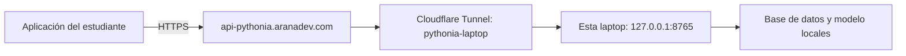

# Esta laptop como servidor de PythonIA

La aplicación de los estudiantes se instala en Windows x64 y se conecta a **`https://api-pythonia.aranadev.com/api/v1`**. El backend, el modelo y las respuestas permanecen en la laptop del docente. No hace falta abrir puertos en el router ni publicar PostgreSQL.



Se prepara un túnel **nuevo**, `pythonia-laptop`, sin modificar `aranadev`, `api`, `api-examenes`, `examenes` ni `www`. Esto es un subdominio, no una subred. La ruta conecta con HTTP local; los clientes usan HTTPS. Véase [publicar aplicaciones con Cloudflare Tunnel](https://developers.cloudflare.com/tunnel/get-started/).

## Preparar una vez en la laptop servidor

Instalar el conector oficial si todavía no existe:

```powershell
winget install --id Cloudflare.cloudflared --exact --source winget
powershell -NoProfile -ExecutionPolicy Bypass -File backend/scripts/cloudflare.ps1 -Accion Autorizar
```

En el navegador iniciar sesión y autorizar **aranadev.com**. No enviar el certificado, tokens ni archivos de credenciales por chat. Después:

```powershell
powershell -NoProfile -ExecutionPolicy Bypass -File backend/scripts/cloudflare.ps1 -Accion Preparar
```

Esto crea el túnel en su cuenta, guarda la configuración en `backend/.runtime/cloudflare/config.yml` y valida el archivo, **sin publicar DNS ni iniciar conexiones**. Las credenciales quedan en `%USERPROFILE%\.cloudflared`. Ambos son privados. El script comprueba que un túnel del mismo nombre tenga credenciales en esta computadora antes de reutilizarlo.

## Antes de publicar

Cambiar la contraseña corta del administrador privado por una segura y verificar el inicio de sesión. Cambiar solamente `ADMIN_PASSWORD` en `.env` **no cambia una cuenta ya creada**. No publicar la instancia demo de puerto 8766 ni compartir su acceso con la base real.

Este despliegue es para una prueba controlada con cuentas de prueba. El ejecutor de código del proyecto no proporciona aislamiento del sistema operativo contra código hostil; el túnel cifra y transporta las peticiones, pero no añade ese aislamiento. Para un servicio abierto permanente se requiere ese endurecimiento adicional.

## Publicar e iniciar

1. Doble clic en `iniciar_backend.bat`. Elegir **1 Normal** o **2 Docker**. Ambos atienden en `127.0.0.1:8765`; ejecutar un solo modo a la vez.
2. Crear el DNS una sola vez:

```powershell
powershell -NoProfile -ExecutionPolicy Bypass -File backend/scripts/cloudflare.ps1 -Accion Publicar
```

3. Doble clic en **`backend/iniciar_tunel.bat`**. Mantener su ventana abierta. `Ctrl+C` desconecta este túnel sin tocar los otros servicios.
4. Comprobar:

```powershell
powershell -NoProfile -ExecutionPolicy Bypass -File backend/scripts/cloudflare.ps1 -Accion Verificar
```

La verificación comprueba identidad del backend local y remoto, salud y rechazo del perfil sin autenticación. No sustituye la prueba en otra laptop ni comprueba inferencia, calificación o persistencia por sí sola. El script no sobrescribe registros DNS existentes.

El conector corre en Windows, **fuera de Docker**; así usa la misma dirección local en ambos modos. Si el conector se ejecutara dentro de otro contenedor, `127.0.0.1` ya no sería la laptop y esta configuración no correspondería.

**Persistencia:** Normal utiliza la URL de base de datos configurada en `backend/.env` (actualmente SQLite local); Docker utiliza PostgreSQL 16 en `db_data`. No se sincronizan. Elegir un modo para todo el piloto; cambiar de modo puede mostrar otra lista de usuarios y respuestas. No ejecutar `docker compose down -v` con datos que se deban conservar.

La laptop debe permanecer encendida, con Internet y sin suspensión. No se instala un servicio automático ni se cambia el plan de energía con estos scripts. Si el túnel se detiene, se reinicia `backend/iniciar_tunel.bat`. Si el backend se detiene, se reinicia `iniciar_backend.bat`.

## Crear y entregar el instalador

```powershell
powershell -NoProfile -ExecutionPolicy Bypass -File scripts/crear_instalador.ps1 -CopiarAlEscritorio
```

Requiere Flutter/Visual Studio para compilar y [Inno Setup](https://jrsoftware.org/isinfo.php). Si ya se compiló esa misma versión y URL, agregar `-SinCompilar`. El manifiesto `entrega.json` evita empaquetar un cliente de otra URL por error. Para otra entrega, aumentar la versión en `app-desktop/pubspec.yaml` antes de compilar.

Genera el EXE, su SHA256 y copia ambos al escritorio junto con `PRUEBA_OTRA_LAPTOP.txt`. Incluye el runtime redistribuible x64 de Visual C++ localizado en la instalación de Visual Studio del equipo de compilación. El instalador usa el icono del proyecto, instala por usuario, crea acceso en Inicio, ofrece acceso de escritorio y permite desinstalar. No incluye backend, modelos, Python, `.env`, credenciales ni base de datos. No tiene firma digital de editor.

En la laptop estudiante no se requieren herramientas de desarrollo. Para ejecutar código interactivo con `input()` debe haber Python 3.11+ disponible como `python` o `py`. Se puede registrar desde la aplicación. La dirección del servidor puede cambiarse en **Configuración → Avanzado → Conexión al backend**.

Seguir [la lista de prueba entre laptops](PRUEBA_OTRA_LAPTOP.txt). Utilizar datos ficticios hasta comprobar separación de usuarios, administración, persistencia e inferencia desde otra red. El instalador y su compilación no demuestran por sí solos que el DNS o el túnel estén activos.
