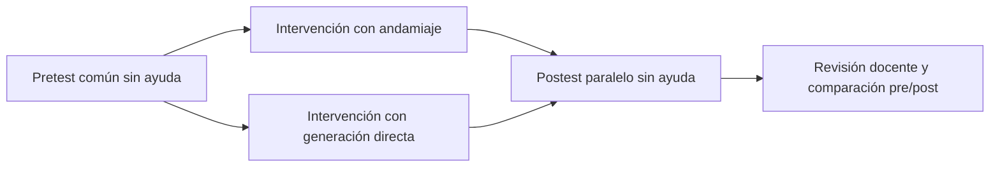

# Protocolo piloto: pretest, intervención y postest

Versión de trabajo: **22 de octubre de 2026**. Banco `piloto-6-v1`. Propuesta pendiente de revisión del profesor y pilotaje: las formas todavía no están validadas como equivalentes en dificultad. No recoge resultados de estudiantes reales.

## Qué se comparará

La variable de intervención es el **andamiaje explicativo**. Ambos grupos utilizan el mismo motor local, los mismos módulos, tareas comunes, tiempo y condiciones de aplicación. El servidor fija el motor y la condición; el estudiante no puede cambiarlos desde el selector.

| Momento | Ambos grupos | Diferencia entre grupos |
|---|---|---|
| Pretest | Sin IA, pistas, historial, soluciones ni ejecución. Misma forma A: código y explicación propia. Se abre desde el explicador | Ninguna ayuda diferenciada |
| Intervención | Los mismos módulos y Retos Curriculares existentes, sin un catálogo de práctica adicional. Se puede generar y ejecutar código | Un grupo recibe código sin comentarios ni docstrings didácticos; el otro puede recibir explicación, pistas y razonamiento. Cuando hay código Python analizable, la pregunta final y las observaciones de literales se anclan al AST real, sin ejecutar el programa ni calificar al estudiante. La práctica previa obligatoria es configurable |
| Postest | Sin IA, pistas, historial, soluciones ni ejecución. Forma B: mismas competencias y rúbrica, otros datos y contextos. Se abre desde el editor | Ninguna ayuda diferenciada |

El postest se **resuelve por el estudiante**, no se encarga al agente. Si el agente lo resolviera, se mediría su rendimiento en lugar del aprendizaje independiente. Los formularios pre y post tienen el mismo tipo de respuesta: escribir código y explicar brevemente. Cambiar únicamente de lectura de código en pre a producción en post introduciría otra diferencia difícil de separar del aprendizaje.

La intervención utiliza los retos de los módulos existentes. En el editor, el grupo directo puede copiar la consigna del reto o generar código, sin mostrar pistas ni guía docente. En el explicador, el grupo con andamiaje trabaja las lecciones existentes y registra su predicción y razonamiento antes de solicitar explicación cuando esa opción está activada. No se añade otro conjunto de tareas. Los instrumentos pre/post seleccionan competencias del currículo, sin cubrir necesariamente todas sus lecciones, y el profesor debe aprobar esa selección antes de recoger datos.

La explicación tiene controles estructurales: cuando se pidió solo explicar y el modelo altera el programa, puede intervenir un respaldo estático identificado en pantalla. La condición directa incluye comprobaciones de sintaxis y de ciertas importaciones estándar, con un máximo de una reparación. Estas ayudas de implementación forman parte del sistema que se evalúa; deben declararse y mantenerse estables durante el ensayo. No constituyen una validación general del modelo ni permiten asegurar ausencia de errores.

La generación directa también puede completar una impresión expresamente solicitada si el código del modelo recoge una variable con input en el ámbito principal y después no la utiliza. Este ajuste no inventa datos: utiliza la entrada escrita por el alumno. En la intervención, los programas con input se ejecutan en la terminal del equipo del estudiante; se debe comprobar que todos tengan Python y las mismas condiciones de ejecución. No se suministran números automáticos para ocultar fallos de entrada. Esta configuración debe permanecer estable durante la recogida de datos.



## Seis pares de preguntas propuestos

Las consignas exactas están en `backend/app/services/estudio_service.py`, se muestran al docente antes de abrir la evaluación y se guardan dentro de cada entrega. Se evalúa un subconjunto de cada módulo: no se afirma cubrir todos los temas, POO ni complejidad algorítmica.

| Par | Módulo | Pretest A | Postest B | Competencia |
|---|---|---|---|---|
| m1_1 | 1 | Guardar Ana y edad 19, mostrar ambos datos y explicarlos | Guardar Juan y año 2004, mostrar ambos datos y explicarlos | Variables y salida |
| m1_2 | 1 | Total de 4 cuadernos a 3, y caso cantidad cero | Total de 5 filas con 6 sillas, y caso cero filas | Variables y multiplicación |
| m2_1 | 2 | if/else: acceso desde edad 18; explicar 17 y 18 | if/else: ventilador desde 30 grados; explicar 29 y 30 | Condición y valor frontera |
| m2_2 | 2 | Sumar [2,4,6] con for; explicar acumulador y lista vacía | Sumar [3,5,7] con for; explicar acumulador y lista vacía | Iteración y acumulación |
| m3_1 | 3 | Función calcular_total(precio,cantidad), return y llamada | Función calcular_distancia(velocidad,horas), return y llamada | Parámetros, retorno y salida |
| m3_2 | 3 | Contar valores mayores que 10; igualdad y lista vacía | Contar valores menores que 5; igualdad y lista vacía | Función con lista, predicado y casos límite |

El profesor puede decidir cinco o seis preguntas desmarcando un par, manteniendo representación de los tres módulos. Los participantes que ya iniciaron conservan sus preguntas. El postest de cada participante conserva los pares de su pretest; una nueva selección no altera retrospectivamente instrumentos ni notas.

## Aplicación desde la cuenta administradora

1. Abrir **Pretest, postest y revisión docente**, botón visible en el área principal para administrador o investigador.
2. Revisar el banco y acordar con el profesor la cantidad, dificultad, rúbrica y tiempos. Realizar un pilotaje con cuentas separadas de las de investigación.
3. Activar **Estudio** para bloquear la ayuda a estudiantes todavía sin asignación. Seleccionar las preguntas y **Abrir pretest**; pulsar **Aplicar activación y preguntas**.
4. En participantes, asignar a cada estudiante su grupo y fase **pre**. La condición queda fijada al iniciar el instrumento para no cambiar a una persona de grupo a mitad del ensayo. Las fases avanzan en orden y no se rebobinan sobre una entrega existente; para otro pilotaje se utilizan cuentas nuevas.
5. Cada estudiante inicia el pretest, escribe sus respuestas y pulsa **Entregar evaluación**. Puede entregar incompleto, en blanco o con errores: no se exige acertar para que se guarde. El borrador se guarda manualmente y cada 15 segundos si hay cambios; solo un acuse del servidor se considera guardado.
6. Confirmar las entregas, cerrar el pretest y asignar **intervención**. El sistema impide avanzar con un pretest abierto sin entregar; con Estudio activo también exige que exista un pretest enviado. Ambas condiciones trabajan las tareas comunes de los tres módulos.
7. Si se desea explicar directamente sin contestar primero una práctica guiada, desactivar su interruptor y pulsar Guardar cambios. Esto no modifica entregas ni cambia al estudiante de grupo. El grupo directo nunca recibe la práctica guiada.
8. Abrir **postest**, aplicar y asignar fase **post**. El estudiante resuelve la otra forma en el editor de evaluación, sin pedir la solución a la IA, y entrega su trabajo.
9. Cerrar el postest cuando termine la sesión. Revisar, exportar y calificar con la rúbrica humana. Las entregas finales son inmutables para el estudiante.

La aplicación actualiza la fase periódicamente. Ante fallos de red no se considera una entrega recibida: se muestra un error, se conserva el texto en la pantalla y debe reintentarse el guardado. Las respuestas ya guardadas pueden recuperarse al volver a entrar. No cerrar la aplicación con cambios pendientes.

Los tiempos de inicio y entrega se toman en el servidor. No existe un cronómetro que cierre automáticamente la prueba: la duración y el cierre se administran siguiendo las indicaciones del supervisor. Sincronizar el reloj del servidor y usar el mismo protocolo para ambos grupos.

## Quién puede calificar

La cuenta administradora puede revisar todo. Para que evalúe otra persona: esa persona registra una **cuenta nueva**, el administrador elige **Autorizar docente** y se concede rol investigador, sin acceso de administrador a las claves del sistema. No se autoriza la cuenta pública de demostración ni una cuenta que ya tenga entregas experimentales. Tras autorizar, la persona docente debe cerrar sesión y entrar de nuevo para actualizar su interfaz.

El panel ofrece revisión ciega para ocultar identidad, grupo y fase en las entregas y en la exportación. El resumen administrativo mantiene la correspondencia por participante. La opción es una ayuda de presentación: no constituye anonimización irreversible frente a quien ya tiene permisos de gestión. Para un evaluador externo, entregar una exportación ciega y custodiar aparte la correspondencia de identidades.

## Rúbrica humana común: 0–10 por pregunta

| Criterio | Puntos | Guía |
|---|---:|---|
| Comprensión y explicación | 0–4 | 0: ausente o sin relación; 1: idea aislada; 2: comprensión parcial; 3: explicación correcta con omisión menor; 4: justificación correcta de variables, operación o flujo y resultado |
| Código y resultado | 0–4 | 0: ausente o sin solución; 1: intento relacionado con errores principales; 2: estructura parcialmente correcta; 3: resuelve el caso principal con detalle menor pendiente; 4: solución ejecutable y coherente con la consigna |
| Caso límite o dato alternativo | 0–2 | 0: no lo contempla; 1: lo identifica parcialmente; 2: lo resuelve/explica correctamente. En variables, el dato alternativo es cambiar el nombre o el dato numérico |

Se aceptan soluciones Python equivalentes y explicaciones cortas o largas. No calificar la cantidad de palabras. Cada par incluye un dato alternativo o un caso límite explícito: cambio del dato numérico en variables, cero en productos, igualdad en condiciones, lista vacía en bucles, parámetro cero en funciones y valores frontera en conteos. Una respuesta vacía no recibe una nota del sistema: el docente la revisa y asigna los puntos correspondientes.

Con seis preguntas: máximo 60 puntos por fase; con cinco: 50. Todas las preguntas tienen igual peso. La IA no asigna las notas ni se generan respuestas correctas visibles durante los tests. La revisión guarda quién calificó, fecha y observaciones. Si se modifica una nota, el panel recalcula los totales; no hay todavía un historial inmutable de todas las revisiones anteriores.

## Datos disponibles y cálculo

Se conserva participante, condición, fase, versión, consignas exactas, código, explicación, preguntas sin responder, borrador/entrega, fechas de inicio/envío y revisión docente. El chat durante la intervención conserva motor real, condición y fase; sus trazas no son una nota de aprendizaje. La cuenta pública compartida se marca DEMOSTRACIÓN y debe excluirse del análisis del ensayo.

El panel muestra el total únicamente después de revisar todas las preguntas de la entrega. Un participante sin pre o post revisado aparece **pendiente**, nunca se inventa una nota cero por falta de datos.

- Porcentaje por fase = puntos obtenidos / máximo del instrumento × 100.
- Cambio descriptivo = porcentaje post − porcentaje pre, en **puntos porcentuales**.
- Ejemplo: 24/60 = 40 %; 36/60 = 60 %; diferencia = **+20 puntos porcentuales**.
- Si pre es cero, el cambio relativo porcentual queda sin calcular; no se divide por cero.
- No se compara automáticamente si cambian competencias, versión o condición.

Una diferencia individual no prueba un efecto causal del andamiaje. Para comparar grupos hay que revisar el nivel inicial, datos faltantes, selección de participantes y posibles factores de confusión. Como referencia metodológica, el [What Works Clearinghouse](https://ies.ed.gov/ncee/wwc/document/256) señala que restar pre del post no basta por sí solo para ajustar diferencias iniciales en un cuasiexperimento. El análisis definitivo deberá acordarse con el profesor y el plan de investigación que se entregue posteriormente.

## Límites antes de trabajar con estudiantes reales

El banco y la rúbrica son propuestas de software para pilotaje, no un instrumento validado. Revisar claridad, dificultad, tiempo, accesibilidad y acuerdo entre evaluadores. Las variantes de contexto no garantizan dificultad igual sin pilotaje; cambiar el nombre por la edad no demuestra por sí solo transferencia de todas las competencias.

Los bloqueos del servidor controlan el sistema, pero no impiden consultar otra aplicación, el repositorio público, Internet o el teléfono. La aplicación del estudio debe ser supervisada. El código que genera el motor puede ser incorrecto: registrar incidencias y decidir previamente un criterio de exclusión/interrupción; no cambiar arbitrariamente la ayuda de un solo grupo.

No activar DNS, túneles ni acceso externo todavía. Se requiere después configurar HTTPS, aislamiento del ejecutor, copias de seguridad, consentimiento y protección de datos. El DNS no sustituye esas medidas.

## Instalación y persistencia

En desarrollo, las tablas nuevas se añaden al iniciar el backend mediante create_all, sin borrar usuarios ni prácticas. Para una base ya desplegada, ejecutar desde backend:

```powershell
.\.venv\Scripts\python.exe scripts/migrar_estudio.py
```

La migración solo añade/verifica configuracion_estudio y entregas_estudio. Es idempotente y exige que exista la tabla usuarios. En Docker, reconstruir la imagen y usar `docker compose --env-file backend/.env exec backend python scripts/migrar_estudio.py`.

API principal: `/estudio/actual`, `/estudio/iniciar`, `/estudio/entregas/{id}`, `/estudio/configuracion` y `/estudio/docente/resumen`. Los endpoints docentes exigen administrador o investigador; autorizar docentes exige administrador. Las exportaciones CSV/JSON se guardan en la carpeta elegida por el docente y están excluidas de Git por nombre.
